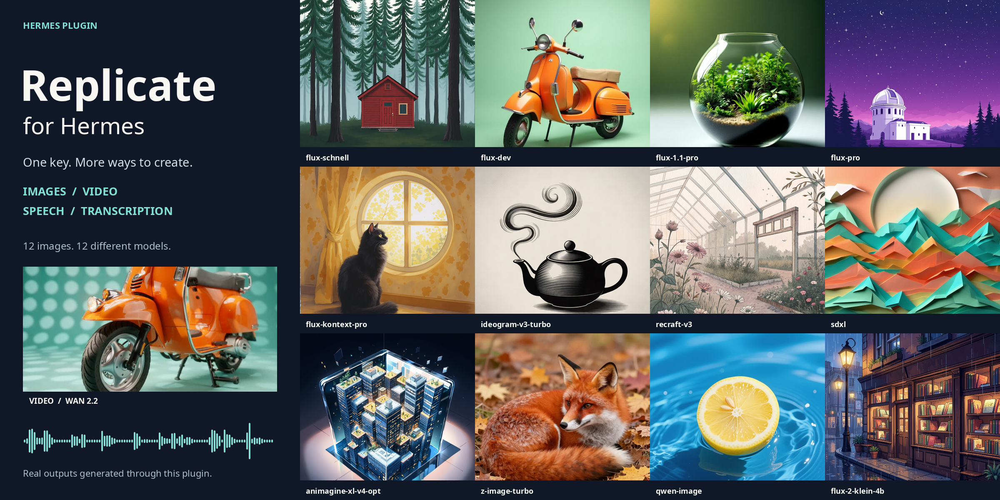

# Hermes Replicate



Native Hermes backends for Replicate image generation, video, transcription and speech. Provider ID `replicate` in all four registries. No desktop extension or custom tools.

All four accept free-text model identifiers, not just the suggested models. Compatibility depends on the model's live schema and the adapter's input/output contract. Live tests produced images from 12 distinct models, a short Wan video, MiniMax speech and a Whisper transcription of that speech. A separate Seedream-3 attempt failed remotely. See [verification](docs/verification.md).

[View the 12-model gallery](docs/assets/model-showcase.png), [video example](docs/assets/video-demo.mp4), [speech example](docs/assets/speech-demo.mp3) and [transcription](docs/assets/transcription-demo.txt).

## Supported interfaces

| Function | Native interface | Default model |
| --- | --- | --- |
| Images | `image_generate` | `black-forest-labs/flux-schnell` |
| Video | `video_generate` | `wan-video/wan-2.2-t2v-fast` |
| Transcription | `transcribe_audio` dispatcher | `openai/whisper` |
| Speech | `text_to_speech` dispatcher | `minimax/speech-02-turbo` |

Model lists are suggestions, not allowlists. The [schema snapshot](docs/model-schemas.json) supplies preset names, not runtime validation or automatic version pins. There is no fallback to another model.

Images use text prompts, with native reference-image and per-call options rejected. Landscape, square and portrait map to `16:9`, `1:1`, `9:16` and, where supported, dimensions 1344×768, 1024×1024, 768×1344. Model defaults supply other inputs unless explicitly configured.

Video advertises text-only generation, `16:9`/`9:16`, 480p/720p and a five-second interface. The default Wan recipe supplies 81 frames at 16 fps where those fields exist, approximately five seconds before model interpolation. Custom model inputs remain schema-dependent; changing models does not expand Hermes' advertised capabilities.

STT uploads a local audio/video file as an inline data URI, at most 20 MiB before base64 expansion. TTS accepts up to 10,000 characters and downloadable MP3/WAV/FLAC output. Voice, speed, language and instructions depend on the selected schema. No streaming STT/TTS, raw PCM, or low-latency voice conversation support.

## Requirements and setup

- Hermes with the four native provider ABCs and `PluginContext.register_*` hooks. Manifest floor: `>=0.23.1`; verify the hooks in your build.
- Python 3.10+, `requests>=2.31,<3`, `jsonschema>=4.18,<5` in the Hermes environment.
- A Replicate API token and billing access to the selected models.

Install from GitHub:

```sh
hermes plugins install jacebenson/hermes-replicate --no-enable
hermes plugins enable replicate
hermes config set image_gen.provider replicate
hermes config set image_gen.model black-forest-labs/flux-schnell
hermes config set video_gen.provider replicate
hermes config set video_gen.model wan-video/wan-2.2-t2v-fast
hermes config set stt.provider replicate
hermes config set stt.model openai/whisper
hermes config set tts.provider replicate
hermes config set tts.model minimax/speech-02-turbo
hermes config set tts.output_format mp3
```

Pin Git installation with `--ref` and a full commit SHA for reproducibility. Restart Hermes after installing. Avoid duplicate enabled plugins named `replicate`. An existing `tts.providers.replicate` command provider takes precedence over native plugin TTS.

Enter the token in Desktop plugin Settings' masked **Replicate API token** field, or use Hermes secret management for `REPLICATE_API_TOKEN`. Keep secrets out of chat, shell history and `config.yaml`. The plugin uses `agent.secret_scope.get_secret` for the active profile.

Desktop Settings exposes free-text `image_model`, `video_model`, `stt_model` and `tts_model` fields, plus corresponding JSON configuration fields. Model selection precedence is the model supplied by the native dispatcher, legacy `<section>.replicate.model`, plugin setting, then default. Sections are `image_gen`, `video_gen`, `stt`, `tts`. The old `REPLICATE_IMAGE_MODEL` override is not read.

## Custom models and mappings

Use `owner/name` or `owner/name:<64-lowercase-hex-version>`. URLs, malformed identifiers and conflicting pins are rejected. An unpinned model resolves its latest version during discovery; the prediction POST uses that resolved immutable version. To retain a specific version across calls, pin it in the identifier or set `version` in model configuration.

For example, this is the Animagine version recorded in the shipped snapshot, not an automatic runtime default:

```text
aisha-ai-official/animagine-xl-v4-opt:cfd0f86fbcd03df45fca7ce83af9bb9c07850a3317303fe8dcf677038541db8a
```

Desktop Settings' `image_config`, `video_config`, `stt_config` and `tts_config` accept JSON objects with only `version`, `input_mapping`, `output_mapping`, `extra_inputs`. The same keys can live under `<section>.replicate` in Hermes configuration, where they override plugin settings.

These exact mapping forms come from the implementation, manifest and offline tests. They illustrate schema contracts, not a promise that an arbitrary model has these fields:

```json
{
  "input_mapping": {"prompt": "description"},
  "output_mapping": "result.0"
}
```

The image test maps the native prompt to a model's `description` field and selects the first URL from `result`. The manifest's STT example is:

```json
{
  "input_mapping": {"audio": "audio_file"},
  "output_mapping": "text",
  "extra_inputs": {"task": "transcribe"}
}
```

A separate pin can be specified as:

```json
{
  "version": "cfd0f86fbcd03df45fca7ce83af9bb9c07850a3317303fe8dcf677038541db8a"
}
```

`input_mapping` maps native names to existing schema fields, never the reverse. Supported names are `prompt`, `text`, `audio`, `voice`, `format`, `instructions`, `initial_prompt`, `language`, `speed`, `duration`, `seed`, `aspect_ratio`, `resolution`, `width`, `height`. Defaults recognize aliases such as `text`/`input_text`, `audio`/`audio_file`, `voice_id`/`voice` and `audio_format`/`format`. Ambiguity requires an explicit mapping; destinations must be unique.

`extra_inputs` supplies model-specific required fields or overrides convenience defaults. It cannot replace the native prompt, text or audio field. Unknown fields, invalid types, enum/range violations and credential/endpoint/webhook keys are rejected before prediction creation. `output_mapping` is a dot-separated object-key/list-index path, checked against the output schema before POST. Media must resolve to an HTTPS URL; transcription must resolve to text. Only the first returned media item is persisted. Not every Replicate model is compatible.

## Discovery, billing and privacy

- Runtime discovery uses authenticated, read-only `GET /v1/models/{owner}/{name}` or `GET /v1/models/{owner}/{name}/versions/{version}` at `api.replicate.com`. It reads input/output schemas without starting inference. These requests disclose the selected model/version and authenticate to Replicate **before any paid prediction POST**, even if later input validation fails.
- Schema metadata is cached in process memory for 300 seconds, at most 32 LRU entries total. Keys include resolved active Hermes home, model name and requested pin. Credentials are checked even on cache hits. No disk schema cache or external schema-reference fetching. Discovery errors stop the request; there is no paid probe or silent model switch.
- Predictions can incur charges. Prompts, configured inputs, voice settings and uploaded audio go to Replicate in `POST /v1/predictions`; polling uses GET. Tokens go only to fixed `api.replicate.com` metadata/prediction endpoints. API requests reject redirects. Model execution, retention and generated-content rights follow Replicate and model terms.
- Polling has a 300-second monotonic budget with request timeouts up to 30 seconds, not a strict whole-operation deadline. Downloads have separate bounds. No automatic prediction retries or remote cancellation. A timeout or failed local save can still be billed; retrying may create another charge.
- Successful outputs persist under the active profile's `cache/generated/` directories. TTS also copies to Hermes' selected output path. Caches are not archives. Session logs may retain prompts, transcripts and paths. The plugin does not persist tokens or raw API/upload bodies.
- Image/video downloads use Hermes media helpers. Audio uses public connect-time SSRF protection, HTTPS, no credentials or environment proxies, no redirects, recognized audio MIME types, a 50 MiB decoded-byte limit and a 60-second async deadline. Partial audio files are removed on failure/cancellation. Audio and transcript cache files are private mode 0600; transcripts are capped at 20 MiB UTF-8. Errors omit arbitrary server bodies and transport exception text.
- Native reference images, image editing, video audio/upscale/reference arguments and generic per-call options are not exposed. Configured `extra_inputs` may supply compatible model fields, but do not add native UI support. Safety defaults and filters do not guarantee safe output.

## Verification

From the checkout, using the Hermes Python environment:

```sh
python -m unittest discover -s tests -v
hermes plugins doctor . --ci
hermes plugins validate .
```

The current offline suite passes 36 tests with mocked HTTP and real installed Hermes contracts. It does not establish model entitlement, pricing or live inference for untested models. [Verification details and remaining checks](docs/verification.md).

Sources: [Hermes plugin API](https://hermes-agent.nousresearch.com/docs/developer-guide/plugins/public-api), [image provider contract](https://hermes-agent.nousresearch.com/docs/developer-guide/image-gen-provider-plugin), [video provider contract](https://hermes-agent.nousresearch.com/docs/developer-guide/video-gen-provider-plugin), [Replicate HTTP API](https://replicate.com/docs/reference/http).

## License

MIT, copyright Jace Benson. See [LICENSE](LICENSE). This license covers plugin code, not model weights or service terms. No guarantee of price, latency, availability or output quality.
